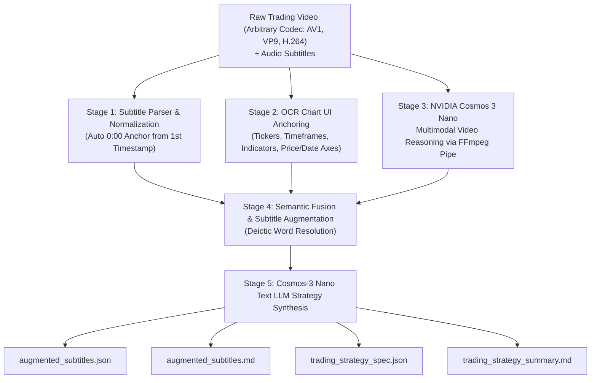

# 📈 Trading Video Understanding with NVIDIA Cosmos 3 Nano (POC)

Proof-of-Concept (POC) determining how to extract deep technical trading strategy reasoning from Video trading videos using **NVIDIA Cosmos 3 Nano** multimodal foundation models.

The pipeline is **100% generic, autonomous, and model-driven**, supporting arbitrary video formats (AV1, VP9, H.264), dynamic subtitle timestamp normalization to `0:00`, dual-mode visual perception & text LLM reasoning, and peak GPU VRAM tracking on the NVIDIA DGX Spark (NVIDIA GB10 GPU).

---

## 🎯 Problem Statement
Financial chart tutorials frequently suffer from severe ambiguity in audio transcripts alone:
- Presenters use heavily deictic language: *"as you can see here"*, *"this candle left and right"*, *"boom boom"*, *"at this particular point is 1927"*, *"nice buy zone in between this level"*.
- Without visual perception, an LLM cannot identify:
  1. The asset (`NVDA · 1W · NASDAQ · Heikin Ashi` or `OANDA AUD/CAD`).
  2. The exact breakout levels ($19.27 on Jan 30, 2023).
  3. The structural swing points (Fractal 3-bar pivot validation).
  4. The multi-month accumulation buy zone ($75.61 - $97.40).
  5. Indicator divergences (price making higher highs while RSI makes lower highs).

---

## 🏗️ Architecture Overview

The system operates across a 5-stage multimodal perception and reasoning pipeline:



1. **Stage 1 (Temporal Alignment):** Parses subtitle timestamp blocks and automatically subtracts the first timestamp (`39:46` or `18:40`), anchoring the clip to `00:00`. Uses `ffprobe` to determine exact video duration.
2. **Stage 2 (Visual Grounding):** Extracts OCR text and technical indicator labels (RSI, MA, MACD), potential ticker symbols, and numerical levels using EasyOCR.
3. **Stage 3 (Cosmos-3 Nano Video Reasoning):** Extracts frames via an in-memory FFmpeg streaming pipe (natively supporting AV1, VP9, H.264) and runs NVIDIA Cosmos 3 Nano (`Cosmos3OmniForConditionalGeneration` in BF16) on GPU to analyze candlestick trajectories, drawn trendlines, indicator states, and breakout zones.
4. **Stage 4 (Multimodal Fusion):** Replaces ambiguous verbal words with explicit chart entities, exact numerical price levels, calendar dates, and structural concepts.
5. **Stage 5 (Cosmos-3 Nano Text LLM Synthesis):** Prompts Cosmos 3 Nano as a text LLM to formulate formal algorithmic trading rules (entry triggers, invalidation stops, profit targets).
6. **VRAM Monitoring:** Real-time tracking of peak GPU memory allocated and reserved.

---

## 📊 Peak VRAM Usage Profiling (NVIDIA DGX Spark GB10)

| Metric | Clip 1 (`trading_lesson.clip.mp4`) | Clip 2 (`trading_lesson_2.clip.mp4`) |
|---|---|---|
| **Peak VRAM Allocated** | **16.913 GB** | **17.041 GB** |
| **Peak VRAM Reserved** | **17.076 GB** | **17.205 GB** |
| **Total System VRAM** | 128.000 GB | 128.000 GB |
| **Remaining VRAM Headroom** | **~110.8 GB** | **~110.8 GB** |

---

## 🚀 Running the Pipeline (Dockerized)

Execute the pipeline on the NVIDIA DGX Spark GPU server (`ssh user@dgx-spark`):

### 1. Run on Clip 1 (Market Structure & Demand Retest):
```bash
ssh user@dgx-spark "docker run --rm --gpus all \
  -v /workspace:/workspace \
  -v /mnt/edrive/huggingface:/mnt/edrive/huggingface:ro \
  -e HF_HOME=/mnt/edrive/huggingface \
  -e WANDB_MODE=offline \
  trader-vids:latest /workspace/pipeline.py \
  --video /workspace/trading_lesson.clip.mp4 \
  --subtitles /workspace/subtitles_clip \
  --output_dir /workspace/outputs_clip_1 \
  --num_samples 3"
```

### 2. Run on Clip 2 (RSI Momentum Divergence & Resistance Reversal):
```bash
ssh user@dgx-spark "docker run --rm --gpus all \
  -v /workspace:/workspace \
  -v /mnt/edrive/huggingface:/mnt/edrive/huggingface:ro \
  -e HF_HOME=/mnt/edrive/huggingface \
  -e WANDB_MODE=offline \
  trader-vids:latest /workspace/pipeline.py \
  --video /workspace/trading_lesson_2.clip.mp4 \
  --subtitles /workspace/subtitles_clip_2 \
  --output_dir /workspace/outputs_clip_2 \
  --num_samples 3"
```

### 3. Run on Any New Video:
Drop your new video (`my_trading_video.mp4`) and subtitle file (`my_subtitles`) into `/workspace/` on the DGX Spark server and run:
```bash
ssh user@dgx-spark "docker run --rm --gpus all \
  -v /workspace:/workspace \
  -v /mnt/edrive/huggingface:/mnt/edrive/huggingface:ro \
  -e HF_HOME=/mnt/edrive/huggingface \
  -e WANDB_MODE=offline \
  trader-vids:latest /workspace/pipeline.py \
  --video /workspace/my_trading_video.mp4 \
  --subtitles /workspace/my_subtitles \
  --output_dir /workspace/outputs_my_video \
  --num_samples 3"
```

### Optional Command-Line Arguments:
- `--video <path>`: Path to the input MP4 video file (default: `/workspace/trading_lesson.clip.mp4`).
- `--subtitles <path>`: Path to the subtitle transcript file (default: `/workspace/subtitles_clip`).
- `--output_dir <path>`: Output directory for JSON & Markdown artifacts (default: `/workspace/outputs`).
- `--model_path <path>`: Local directory containing the Cosmos 3 Nano model snapshot.
- `--num_samples <int>`: Number of milestone video intervals to sample through Cosmos multimodal reasoning (default: `3`).
- `--skip_model`: Skips model loading for rapid offline pipeline testing.

---

## 📂 Output Artifacts
Each pipeline run populates the specified output directory with:
- `augmented_subtitles.json`: Full structured JSON containing timestamped records, visual observations, resolved deictic references, and peak VRAM stats.
- `augmented_subtitles.md`: Side-by-side comparative table mapping raw spoken text to visual chart state and trading rules.
- `trading_strategy_spec.json`: Formatted algorithmic trading rules (entry triggers, invalidation stops, profit targets) synthesized by Cosmos-3 Nano.
- `trading_strategy_summary.md`: Executive POC evaluation and hardware profiling report.
