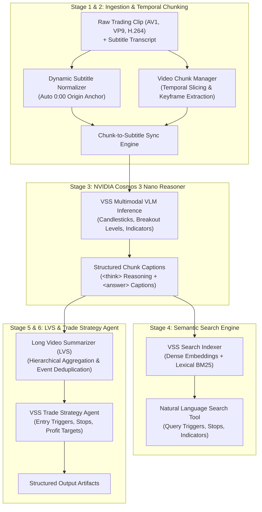

# 🎬 NVIDIA Video Search and Summarization (VSS) Trading Pipeline

Implementation of the **NVIDIA AI Blueprint for Video Search and Summarization (VSS)** tailored specifically for extracting actionable trading ideas, market structure rules, and execution plans from technical trading video clips and synchronized subtitles.

Reference architecture based on:  
[NVIDIA-AI-Blueprints/video-search-and-summarization](https://github.com/NVIDIA-AI-Blueprints/video-search-and-summarization)

---

## 💡 Overview & Problem Statement

Financial chart tutorials and trading webinars rely heavily on informal, ambiguous verbal phrases:
- Presenters say: *"as you can see here"*, *"this candle left and right"*, *"boom boom"*, *"at this particular point is 1927"*, *"nice buy zone in between this level"*.
- Without visual perception, an LLM cannot ground these statements into actionable trading parameters.

The **NVIDIA VSS Trading Pipeline** replaces ad-hoc scripts with the official **NVIDIA VSS Blueprint reference architecture**, enhanced to natively support:
1. **Arbitrary video codecs** (AV1, VP9, H.264) via streaming FFmpeg pipes.
2. **Dynamic clip and subtitle synchronization** (automatically detecting the clip's offset, e.g. `18:40` or `39:46`, and anchoring it to `0:00`).
3. **Multimodal chart reasoning** with **NVIDIA Cosmos 3 Nano** (`Cosmos3OmniForConditionalGeneration` in BF16) on GPU.
4. **Hybrid semantic search** over indexed video intervals (dense vector embeddings + lexical BM25).
5. **Long Video Summarization (LVS)** aggregating chunk-level observations into chronological trading milestone events.
6. **Algorithmic trade idea synthesis** generating formal execution rules (entry triggers, invalidation stops, profit targets, and confluences).

---

## 🏗️ Architecture



---

## 📂 Repository Structure

```
├── config.py                 # Dataclasses and environment configurations
├── schemas.py                # Pydantic schemas (VSS OpenAPI and data contracts)
├── utils.py                  # Shared helpers (safe JSON loading, Markdown cleaning, NLP heuristics)
├── subtitle_sync.py          # Dynamic subtitle parsing, 0:00 anchoring, and window alignment
├── chunk_engine.py           # FFmpeg-based video chunking and frame extraction
├── downloader.py             # yt-dlp video/subtitle downloader and local metadata cache
├── vlm_reasoner.py           # Cosmos 3 Nano multimodal perception and reasoning engine
├── nemotron_reasoner.py      # OpenAI-compatible Nemotron 3.5 Lightning reasoning client
├── strategy_breakdown.py     # Multi-strategy segment breakdown and algorithmic template engine
├── search_engine.py          # Hybrid vector and keyword semantic search index
├── summarizer.py             # Long Video Summarization (LVS) and milestone event aggregator
├── trade_strategy_agent.py   # Algorithmic trade idea and execution rule synthesizer
├── pipeline.py               # Master end-to-end VSS pipeline runner
├── vss_cli.py                # Unified CLI (summarize, search, trade-idea, serve)
├── server.py                 # FastAPI microservice implementing VSS REST endpoints
├── README.md                 # Complete documentation and usage instructions
└── tests/                    # Comprehensive unit & integration test suite (41 tests)
    ├── test_api_server.py
    ├── test_chart_grounding.py
    ├── test_chunk_engine.py
    ├── test_orchestrator.py
    ├── test_pixel_grounding.py
    ├── test_search_engine.py
    ├── test_subtitle_sync.py
    ├── test_trade_strategy.py
    └── test_utils.py
```

---

## 🚀 Running on NVIDIA DGX Spark GPU System (GB10)

The entire pipeline executes directly on the NVIDIA DGX Spark GPU workstation (GB10 GPU), which hosts both local high-performance inference (Nemotron 3.5 Lightning, NVIDIA Cosmos 3 Nano, YOLO-World) and the interactive web interface.

### ⚡ Setting Up Local Nemotron 3.5 Lightning on the GB10 GPU

To start the local Nemotron 3.5 Lightning reasoning server using `sparkrun`:
```bash
sparkrun run nemotron3.5-nvfp4.yaml
```
This serves Nemotron 3.5 Lightning in NVFP4 precision at `http://localhost:8000/v1`, providing instant token streaming with zero cloud API cost.

### 🧠 Hybrid LLM Hierarchy (Local Workhorse + Sparing Ultra Cloud Reasoning)
1. **Local Workhorse (Default)**: **Nemotron 3.5 Lightning** handles all high-frequency reasoning tasks: per-chunk interpretation, narrative summaries, trade rule extraction, and interactive API requests.
2. **Sparing Cloud High-Reasoning**: When Weights & Biases credentials are configured (via `WANDB_API_KEY` or `~/.wandb_api_key`), **Nemotron 3 Ultra 550B** (`nvidia/NVIDIA-Nemotron-3-Ultra-550B-A55B`) is invoked *sparingly*—specifically for heavy whole-video global multi-strategy stitching where viewing the entire 40+ minute video context at once provides superior boundary delineation.
3. **Resilient Disk Caching**: All VLM and LLM completions are hashed via SHA-256 and cached on disk (`.cache/llm/`, `.cache/crops/`), preventing redundant inference passes or token expenditures.

---

### 🎯 Deterministic Pixel Computer Vision Chart Grounding
Instead of unreliable object detectors (like YOLO, which mistakes charts for "laptops" or "tv screens"), this repository uses a deterministic hybrid visual grounding engine:
- **Pixel Geometry (`grounding/layout.py`, `drawings.py`)**: OpenCV and NumPy segmentation to locate the chart pane, price axis, time axis, colored demand/supply zones, horizontal price levels, and TradingView long/short position tools across light and dark themes.
- **Axis Regression Calibration (`grounding/axis.py`)**: Automatically detects arithmetic tick lattices and performs linear or logarithmic least-squares fits ($price = f(y)$) with $R^2 \ge 0.999$, cross-checking colored axis tags against pixel rows and filtering countdown timers (e.g. `08:53`).
- **3x Zoomed Crop VLM Reading (`grounding/reader.py`)**: Feeds high-resolution 3x zoomed crops of the price axis and 2x crops of the ticker header to the vision model, avoiding full-frame numerical hallucinations.
- **Interactive UI Overlay (`⌗ Grounding`)**: The web player includes a Grounding Overlay toggle that renders detected price lines, zones, and position tools (with entry, stop, target, and risk-reward ratios) directly on top of the paused video.

---

### 🏃 Running the Pipeline

You can run the end-to-end VSS pipeline directly on the DGX Spark system using either Docker or the local Python environment.

#### Option A: Running with Docker (Recommended)
```bash
# Build the production container (if not already built)
docker build -t trader-vids:latest .

# Run on Clip 1 (NVDA Market Structure & Demand Retest):
docker run --rm --gpus all \
  -v $(pwd):/workspace \
  -v /mnt/edrive/huggingface:/mnt/edrive/huggingface:ro \
  -e HF_HOME=/mnt/edrive/huggingface \
  -e WANDB_MODE=offline \
  trader-vids:latest pipeline.py \
  --video /workspace/trading_lesson.clip.mp4 \
  --subtitles /workspace/subtitles_clip \
  --output_dir /workspace/outputs_vss_clip_1 \
  --chunk_duration 35.0 \
  --chunk_overlap 5.0

# Run on Clip 2 (RSI Momentum Divergence & Resistance Reversal):
docker run --rm --gpus all \
  -v $(pwd):/workspace \
  -v /mnt/edrive/huggingface:/mnt/edrive/huggingface:ro \
  -e HF_HOME=/mnt/edrive/huggingface \
  -e WANDB_MODE=offline \
  trader-vids:latest pipeline.py \
  --video /workspace/trading_lesson_2.clip.mp4 \
  --subtitles /workspace/subtitles_clip_2 \
  --output_dir /workspace/outputs_vss_clip_2 \
  --chunk_duration 35.0 \
  --chunk_overlap 5.0

# Run on Any Arbitrary Video:
docker run --rm --gpus all \
  -v $(pwd):/workspace \
  -v /mnt/edrive/huggingface:/mnt/edrive/huggingface:ro \
  -e HF_HOME=/mnt/edrive/huggingface \
  -e WANDB_MODE=offline \
  trader-vids:latest pipeline.py \
  --video /workspace/my_video.mp4 \
  --subtitles /workspace/my_subtitles \
  --output_dir /workspace/outputs_vss_my_video
```

#### Option B: Running Natively
```bash
python3 pipeline.py \
  --video trading_lesson.clip.mp4 \
  --subtitles subtitles_clip \
  --output_dir outputs_vss_clip_1 \
  --chunk_duration 35.0 \
  --chunk_overlap 5.0
```

---

## 🖥️ Interactive Web UI & Video Player

The repository includes a modern, zero-dependency single-page application with live timeline synchronization, dynamic strategy revelation, and interactive visual chart grounding overlays.

### Launching the Web Server
```bash
python3 server.py --host 0.0.0.0 --port 38111
```
Open `http://localhost:38111` in your browser.

---

## 🧪 Testing Strategy

Run the complete 41-test suite directly on the DGX Spark system:

#### 1. Running Tests Natively
```bash
pytest tests/ -v
```

#### 2. Running Tests with Docker
```bash
docker run --rm --gpus all \
  -v $(pwd):/workspace \
  -w /workspace \
  -e PYTHONPATH=/workspace \
  trader-vids:latest pytest tests/ -v
```

**What the test suite validates**:
- **API & Probes (`test_api_server.py`)**: Readiness (`/v1/ready`), liveness (`/v1/live`), health diagnostics (`/v1/healthz`), models catalog, and UI endpoints.
- **Media Streaming**: HTTP 206 Partial Content byte-range seeking and `HEAD` metadata parsing.
- **Deterministic Grounding (`test_chart_grounding.py`, `test_pixel_grounding.py`)**: OpenCV layout segmentation, price coordinate regression ($R^2 \ge 0.999$), TradingView position tool parsing, and bounding box drawing.
- **Temporal Slicing (`test_chunk_engine.py`)**: FFmpeg chunk boundary generation, duration integrity, and keyframe extraction.
- **Durable Orchestration (`test_orchestrator.py`)**: SQLite state persistence, workflow checkpoints, SSE progress emission, and cancellation.
- **Semantic Search (`test_search_engine.py`)**: Dense vector embeddings + lexical BM25 indexing and instant timestamp seek queries.
- **Subtitle Alignment (`test_subtitle_sync.py`)**: Auto-detection of cue offsets and normalized 00:00 temporal anchoring.
- **Algorithmic Strategy Agent (`test_trade_strategy.py`, `test_utils.py`)**: Trade idea synthesis, frequency-based asset identification, directional bias validation, and rule formatting.

#### 3. API & Streaming Smoke Tests
```bash
# Verify UI root
curl -s -o /dev/null -w "UI Root: %{http_code}\n" http://127.0.0.1:38111/

# Verify HTTP Range streaming (206)
curl -s -D - -o /dev/null -H "Range: bytes=0-100" http://127.0.0.1:38111/api/videos/stream/video_1

# Verify Multi-Strategy API response
curl -s -o /dev/null -w "Strategy API: %{http_code}\n" http://127.0.0.1:38111/api/videos/strategies/video_2
```

---

## 🔍 VSS Semantic Video Search

After running the pipeline, query the video index directly with natural language:

```bash
# Query breakout levels
python3 vss_cli.py search \
  --index outputs_vss_clip_1/vss_search_index.json \
  --query "Where does the price break above the swing high?"

# Query entry triggers and buy zones
python3 vss_cli.py search \
  --index outputs_vss_clip_1/vss_search_index.json \
  --query "Where is the consolidation demand buy zone?"
```

---

## 🌐 VSS REST API Service

Launch the FastAPI microservice adhering to the VSS OpenAPI contract:

```bash
python3 vss_cli.py serve --port 38111 --host 0.0.0.0
```

Available endpoints:
- `GET /v1/ready`: Service readiness probe (HTTP 200).
- `GET /v1/live`: Service liveness probe (HTTP 200).
- `GET /v1/healthz`: Health status with real-time GPU VRAM profiling.
- `GET /models`: Lists available models (`nvidia/Cosmos3-Nano`).
- `POST /v1/summarize`: Executes long video summarization on a video clip and subtitle file.
- `POST /v1/search`: Executes semantic search across video chunks.
- `POST /v1/trade_idea`: Synthesizes formal trade rules and execution parameters.

---

## 📦 Output Artifacts

Each pipeline run generates the following artifacts in the designated output directory:
1. `multi_strategy_breakdown.json` & `multi_strategy_breakdown.md`: Multi-strategy breakdown across video timeline chapters synthesized via Nemotron 3.5 Reasoner.
2. `trading_summary.json`: Standard VSS `CompletionResponse` containing the narrative summary, chronological milestone events, and chunk captions.
3. `trading_summary.md`: Human-readable summary report with comparative milestone tables.
4. `trading_strategy_spec.json`: Machine-readable algorithmic trading rules (entry triggers, invalidation stops, profit targets, indicators).
5. `trading_strategy_spec.md`: Polished markdown trade plan for algorithmic execution.
6. `vss_search_index.json`: Vector and keyword search index enabling instant query retrieval.
7. `augmented_subtitles.json` & `augmented_subtitles.md`: Grounded timeline linking spoken subtitle blocks to visual chart confluences.
