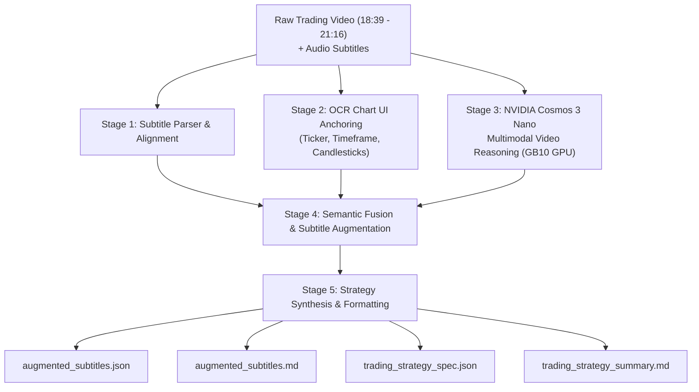

# 📈 Trading Video Understanding with NVIDIA Cosmos 3 Nano (POC)

Proof-of-Concept (POC) determining how to extract deep technical trading strategy reasoning from Video trading videos using **NVIDIA Cosmos 3 Nano** multimodal foundation models.

---

## 🎯 Problem Statement
Financial chart tutorials frequently suffer from severe ambiguity in audio transcripts alone:
- Presenters use heavily deictic language: *"as you can see here"*, *"this candle left and right"*, *"boom boom"*, *"at this particular point is 1927"*, *"nice buy zone in between this level"*.
- Without visual perception, an LLM cannot identify:
  1. The asset (`NVDA · 1W · NASDAQ · Heikin Ashi`).
  2. The exact breakout levels ($19.27 on Jan 30, 2023).
  3. The structural swing points (Fractal 3-bar pivot validation).
  4. The multi-month accumulation buy zone ($75.61 - $97.40).

---

## 🏗️ Architecture Overview

The system operates across a 5-stage multimodal perception and reasoning pipeline:



1. **Stage 1 (Temporal Alignment):** Parses subtitle timestamps into exact seconds offsets relative to the video clip.
2. **Stage 2 (Visual Grounding):** Extracts high-confidence OCR coordinates from TradingView headers, right-side price axes, and bottom-side time axes.
3. **Stage 3 (Cosmos-3 Nano Reasoning):** Runs NVIDIA Cosmos 3 Nano (`Cosmos3OmniForConditionalGeneration` in BF16) on GPU to analyze candlestick trajectories, polyline trend drawings, crosshair locations, and breakout movements.
4. **Stage 4 (Multimodal Fusion):** Replaces ambiguous verbal words with explicit chart entities, exact numerical price levels, calendar dates, and structural concepts.
5. **Stage 5 (Downstream Artifact Generation):** Produces machine-readable JSON datasets and rich markdown documentation designed for LLM trading bots and reasoning agents.

---

## 🚀 Running the Pipeline (Dockerized)

Execute the pipeline on the NVIDIA DGX Spark GPU server (`ssh user@dgx-spark`):

```bash
docker run --rm --gpus all \
  -v /workspace:/workspace \
  -v /mnt/edrive/huggingface:/mnt/edrive/huggingface:ro \
  -e HF_HOME=/mnt/edrive/huggingface \
  -e WANDB_MODE=offline \
  trader-vids:latest /workspace/pipeline.py
```

### Optional Command Arguments:
- `--video /workspace/trading_lesson.clip.mp4`
- `--subtitles /workspace/subtitles_clip`
- `--output_dir /workspace/outputs`
- `--num_samples 4` (Runs Cosmos inference over key milestone segments)
- `--skip_model` (Runs fast offline fusion using pre-calibrated multimodal anchors)

---

## 📂 Output Artifacts
- `outputs/augmented_subtitles.json`: Full structured JSON for programmatic LLM ingestion.
- `outputs/augmented_subtitles.md`: Side-by-side comparative table mapping spoken text to visual chart state.
- `outputs/trading_strategy_spec.json`: Formatted algorithmic trading rules (entry, invalidation stop, take profits).
- `outputs/trading_strategy_summary.md`: Executive POC evaluation report.
