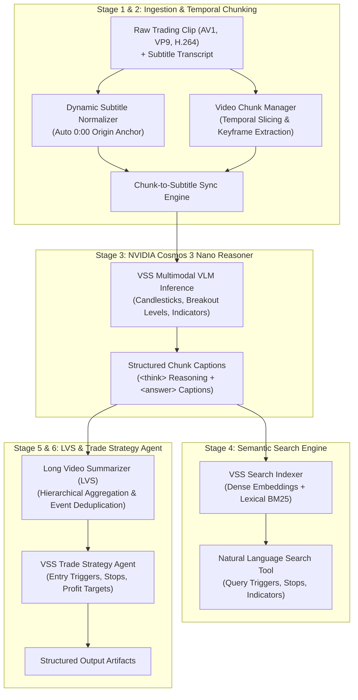

# 🎬 NVIDIA Video Search and Summarization (VSS) Trading Pipeline

Implementation of the **NVIDIA AI Blueprint for Video Search and Summarization (VSS)** tailored specifically for extracting actionable trading ideas, market structure rules, and execution plans from technical trading video clips and synchronized subtitles.

Reference architecture based on:  
[NVIDIA-AI-Blueprints/video-search-and-summarization](https://github.com/NVIDIA-AI-Blueprints/video-search-and-summarization)

---

## 💡 Overview & Problem Statement

Financial chart tutorials and trading webinars rely heavily on informal, ambiguous verbal phrases:
- Presenters say: *"as you can see here"*, *"this candle left and right"*, *"boom boom"*, *"at this particular point is 1927"*, *"nice buy zone in between this level"*.
- Without visual perception, an LLM cannot ground these statements into actionable trading parameters.

The **NVIDIA VSS Trading Pipeline** replaces ad-hoc scripts with the official **NVIDIA VSS Blueprint reference architecture**, enhanced to natively support:
1. **Arbitrary video codecs** (AV1, VP9, H.264) via streaming FFmpeg pipes.
2. **Dynamic clip and subtitle synchronization** (automatically detecting the clip's offset, e.g. `18:40` or `39:46`, and anchoring it to `0:00`).
3. **Multimodal chart reasoning** with **NVIDIA Cosmos 3 Nano** (`Cosmos3OmniForConditionalGeneration` in BF16) on GPU.
4. **Hybrid semantic search** over indexed video intervals (dense vector embeddings + lexical BM25).
5. **Long Video Summarization (LVS)** aggregating chunk-level observations into chronological trading milestone events.
6. **Algorithmic trade idea synthesis** generating formal execution rules (entry triggers, invalidation stops, profit targets, and confluences).

---

## 🏗️ Architecture



---

## 📂 Repository Structure

```
├── config.py                 # Dataclasses and environment configurations
├── schemas.py                # Pydantic schemas (VSS OpenAPI and data contracts)
├── utils.py                  # Shared helpers (safe JSON loading, Markdown cleaning, NLP heuristics)
├── subtitle_sync.py          # Dynamic subtitle parsing, 0:00 anchoring, and window alignment
├── chunk_engine.py           # FFmpeg-based video chunking and frame extraction
├── downloader.py             # yt-dlp video/subtitle downloader and local metadata cache
├── vlm_reasoner.py           # Cosmos 3 Nano multimodal perception and reasoning engine
├── nemotron_reasoner.py      # OpenAI-compatible Nemotron 3.5 Lightning reasoning client
├── strategy_breakdown.py     # Multi-strategy segment breakdown and algorithmic template engine
├── search_engine.py          # Hybrid vector and keyword semantic search index
├── summarizer.py             # Long Video Summarization (LVS) and milestone event aggregator
├── trade_strategy_agent.py   # Algorithmic trade idea and execution rule synthesizer
├── pipeline.py               # Master end-to-end VSS pipeline runner
├── vss_cli.py                # Unified CLI (summarize, search, trade-idea, serve)
├── server.py                 # FastAPI microservice implementing VSS REST endpoints
├── README.md                 # Complete documentation and usage instructions
└── tests/                    # Comprehensive unit test suite (19 tests)
    ├── test_api_server.py
    ├── test_chunk_engine.py
    ├── test_search_engine.py
    ├── test_subtitle_sync.py
    ├── test_trade_strategy.py
    └── test_utils.py
```

---

## 🚀 Running on NVIDIA DGX Spark GPU Server

The pipeline executes inside the Docker container on the NVIDIA DGX Spark GPU system (`ssh user@dgx-spark`).

### 1. Run on Clip 1 (NVDA Market Structure & Demand Retest):
```bash
ssh user@dgx-spark "docker run --rm --gpus all \
  -v /workspace:/workspace \
  -v /mnt/edrive/huggingface:/mnt/edrive/huggingface:ro \
  -e HF_HOME=/mnt/edrive/huggingface \
  -e WANDB_MODE=offline \
  trader-vids:latest pipeline.py \
  --video /workspace/trading_lesson.clip.mp4 \
  --subtitles /workspace/subtitles_clip \
  --output_dir /workspace/outputs_vss_clip_1 \
  --chunk_duration 35.0 \
  --chunk_overlap 5.0"
```

### 2. Run on Clip 2 (RSI Momentum Divergence & Resistance Reversal):
```bash
ssh user@dgx-spark "docker run --rm --gpus all \
  -v /workspace:/workspace \
  -v /mnt/edrive/huggingface:/mnt/edrive/huggingface:ro \
  -e HF_HOME=/mnt/edrive/huggingface \
  -e WANDB_MODE=offline \
  trader-vids:latest pipeline.py \
  --video /workspace/trading_lesson_2.clip.mp4 \
  --subtitles /workspace/subtitles_clip_2 \
  --output_dir /workspace/outputs_vss_clip_2 \
  --chunk_duration 35.0 \
  --chunk_overlap 5.0"
```

### 3. Run on Any New Video:
```bash
ssh user@dgx-spark "docker run --rm --gpus all \
  -v /workspace:/workspace \
  -v /mnt/edrive/huggingface:/mnt/edrive/huggingface:ro \
  -e HF_HOME=/mnt/edrive/huggingface \
  -e WANDB_MODE=offline \
  trader-vids:latest pipeline.py \
  --video /workspace/my_video.mp4 \
  --subtitles /workspace/my_subtitles \
  --output_dir /workspace/outputs_vss_my_video"
```

## 🔄 Dual Repository Architecture: Local (Mac) vs Remote (DGX Spark GPU)

This project operates across **two distinct development environments**:
1. **Local Machine (macOS)**: Where lightweight development, local testing, yt-dlp downloading, and the interactive web interface execute.
2. **Remote GPU Server (NVIDIA DGX Spark)**: Where heavy GPU multimodal perception (NVIDIA Cosmos 3 Nano) and LLM reasoning (Nemotron 3.5 on port 8000) take place.

### Environment Matrix

| Property | Local Environment (macOS) | Remote Environment (NVIDIA DGX Spark) |
|---|---|---|
| **Host / User** | Local workstation (`mac`) | `user@dgx-spark` (passwordless SSH) |
| **Path** | `/Users/armaankapoor/Desktop/coding/trading-video-understanding` | `/workspace` |
| **Git Branch** | `master` (independent clone) | `master` (independent clone) |
| **Primary Role** | Fast UI dashboard, video remuxing, API server, rapid test execution | High-VRAM GPU inference, Cosmos 3 Nano VLM, Nemotron 3.5 Reasoner |
| **Python Env** | `./.venv/bin/python` (Python 3.14) | Docker container `trader-vids:latest` (Linux aarch64, Python 3.12) |
| **Inference Services** | Connects to remote services or local mocks | Cosmos 3 Nano GPU + Nemotron 3.5 Lightning on port 8000 (`http://localhost:8000/v1`) |

---

### 🤖 LLM & Developer Protocol: Dual Git Commit & Synchronization

> [!IMPORTANT]
> **Strict Synchronization Rule**: The local workspace and the remote repository are **separate Git clones**. Changes made locally are **not** automatically reflected on DGX Spark, and vice versa. Whenever any developer or LLM modifies code files, you **MUST** follow this exact 4-step synchronization and dual-commit procedure:

#### Step 1: Stage and Commit Locally
Verify changes and commit them cleanly on local `master`:
```bash
git status
git add <modified_files>
git commit -m "Descriptive commit message"
```

#### Step 2: Sync Code Files to DGX Spark via Rsync
Push modified code files, templates, and tests to DGX Spark (carefully excluding local `.git`, virtual environments, video binaries, and model checkpoints):
```bash
rsync -avz \
  --exclude='.git' \
  --exclude='.venv' \
  --exclude='videos' \
  --exclude='outputs_*' \
  *.py templates/ tests/ \
  user@dgx-spark:/workspace/
```

#### Step 3: Run Remote Tests & Commit on DGX Spark
Execute the test suite inside the Docker container on DGX Spark, then commit the synchronized changes to the remote Git tree:
```bash
# 1. Run Docker test suite on DGX Spark
ssh user@dgx-spark "docker run --rm -e PYTHONPATH=/workspace --entrypoint pytest -v /workspace:/workspace -w /workspace trader-vids:latest tests/ -v"

# 2. Stage and commit on DGX Spark
ssh user@dgx-spark "cd /workspace && \
  git add -A && \
  git commit -m 'Descriptive commit message'"
```

#### Step 4: Verify Both Repositories are Clean
Ensure both repositories report a clean working directory:
```bash
git status
ssh user@dgx-spark "cd /workspace && git status"
```

---

### 🧪 Testing Strategy: What Tests to Run on Each

#### 1. Local Tests (macOS)
Run the full 19-test suite using the local virtual environment:
```bash
./.venv/bin/pytest tests/ -v
```
**What this validates**:
- FastAPI REST probes (`/v1/ready`, `/v1/live`, `/v1/healthz`).
- Model listings (`/models`).
- Web UI template rendering (validates clean 2-tab layout: `Strategy Breakdown` and `Semantic Video Search`, verifying obsolete tabs are absent).
- Video streaming HTTP Range (`HTTP 206 Partial Content`) and `HEAD` request handling.
- Video video metadata, download tracking, and status retrieval.
- Hybrid semantic search index query matching and score thresholds.
- Multi-strategy breakdown extraction and JSON schema compliance.
- Subtitle parsing, 0:00 temporal anchoring, and chunk boundary normalization.

#### 2. Remote Docker Tests (NVIDIA DGX Spark)
Run the test suite inside the production `trader-vids:latest` container:
```bash
ssh user@dgx-spark "docker run --rm -e PYTHONPATH=/workspace --entrypoint pytest -v /workspace:/workspace -w /workspace trader-vids:latest tests/ -v"
```
**What this validates**:
- Linux aarch64 runtime and dependency compatibility.
- Seamless container filesystem mounts and environment variables (`PYTHONPATH=/workspace`).
- Live GPU reasoning integration with Nemotron 3.5 Lightning (`http://localhost:8000/v1`).

#### 3. Local API & Streaming Smoke Tests
Quickly verify live HTTP responses from the local uvicorn server (`http://127.0.0.1:8088`):
```bash
# Verify UI root
curl -s -o /dev/null -w "UI Root: %{http_code}\n" http://127.0.0.1:8088/

# Verify HTTP Range streaming (206)
curl -s -D - -o /dev/null -H "Range: bytes=0-100" http://127.0.0.1:8088/api/videos/stream/video_1

# Verify Multi-Strategy API response
curl -s -o /dev/null -w "Strategy API: %{http_code}\n" http://127.0.0.1:8088/api/videos/strategies/video_2
```

---

## 🔍 VSS Semantic Video Search

After running the pipeline, query the video index directly with natural language:

```bash
# Query breakout levels
python3 vss_cli.py search \
  --index outputs_vss_clip_1/vss_search_index.json \
  --query "Where does the price break above the swing high?"

# Query entry triggers and buy zones
python3 vss_cli.py search \
  --index outputs_vss_clip_1/vss_search_index.json \
  --query "Where is the consolidation demand buy zone?"
```

---

## 🌐 VSS REST API Service

Launch the FastAPI microservice adhering to the VSS OpenAPI contract:

```bash
python3 vss_cli.py serve --port 38111 --host 0.0.0.0
```

Available endpoints:
- `GET /v1/ready`: Service readiness probe (HTTP 200).
- `GET /v1/live`: Service liveness probe (HTTP 200).
- `GET /v1/healthz`: Health status with real-time GPU VRAM profiling.
- `GET /models`: Lists available models (`nvidia/Cosmos3-Nano`).
- `POST /v1/summarize`: Executes long video summarization on a video clip and subtitle file.
- `POST /v1/search`: Executes semantic search across video chunks.
- `POST /v1/trade_idea`: Synthesizes formal trade rules and execution parameters.

---

## 📦 Output Artifacts

Each pipeline run generates the following artifacts in the designated output directory:
1. `multi_strategy_breakdown.json` & `multi_strategy_breakdown.md`: Multi-strategy breakdown across video timeline chapters synthesized via Nemotron 3.5 Reasoner.
2. `trading_summary.json`: Standard VSS `CompletionResponse` containing the narrative summary, chronological milestone events, and chunk captions.
3. `trading_summary.md`: Human-readable summary report with comparative milestone tables.
4. `trading_strategy_spec.json`: Machine-readable algorithmic trading rules (entry triggers, invalidation stops, profit targets, indicators).
5. `trading_strategy_spec.md`: Polished markdown trade plan for algorithmic execution.
6. `vss_search_index.json`: Vector and keyword search index enabling instant query retrieval.
7. `augmented_subtitles.json` & `augmented_subtitles.md`: Grounded timeline linking spoken subtitle blocks to visual chart confluences.
