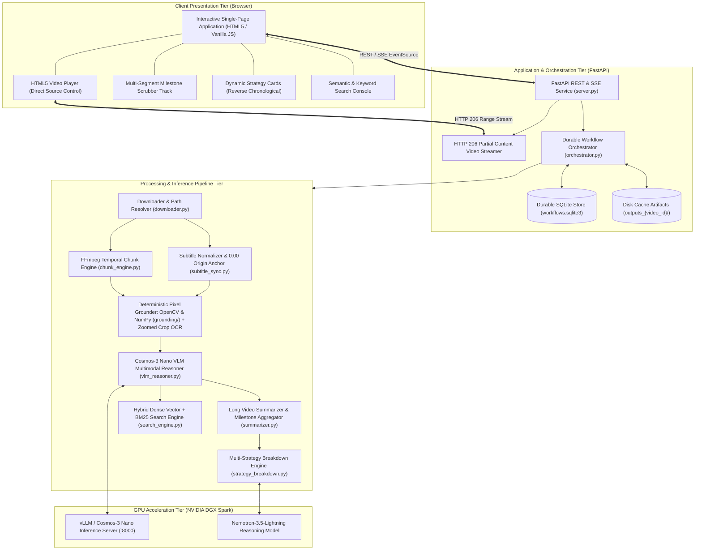
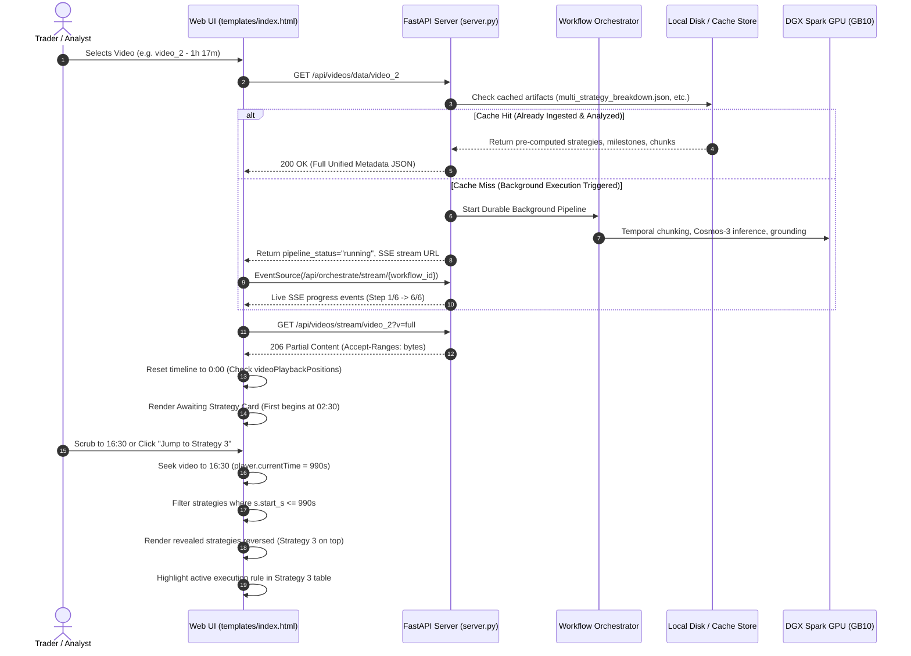

# 🏛️ Architecture & System Design: Trading Video Understanding

Comprehensive architectural specification and design decisions for the **NVIDIA Video Search and Summarization (VSS) Trading Pipeline & Interactive Video Intelligence Platform**.

---

## 📑 Table of Contents

1. [Executive Summary & Problem Statement](#1-executive-summary--problem-statement)
2. [High-Level System Architecture](#2-high-level-system-architecture)
3. [End-to-End Data Flow](#3-end-to-end-data-flow)
4. [Subsystem Deep Dives](#4-subsystem-deep-dives)
   - [4.1 Video Ingestion & HTTP 206 Streaming Engine](#41-video-ingestion--http-206-streaming-engine)
   - [4.2 Temporal Chunking & Subtitle Origin Anchoring](#42-temporal-chunking--subtitle-origin-anchoring)
   - [4.3 Multimodal Perception & Hybrid Visual Grounding](#43-multimodal-perception--hybrid-visual-grounding)
   - [4.4 Multi-Strategy Deconstruction Engine](#44-multi-strategy-deconstruction-engine)
   - [4.5 Durable Orchestration & Background Execution](#45-durable-orchestration--background-execution)
   - [4.6 Interactive Timeline & Live Playback Sync](#46-interactive-timeline--live-playback-sync)
   - [4.7 Semantic Search & Vector/BM25 Hybrid Retrieval](#47-semantic-search--vectorbm25-hybrid-retrieval)
5. [User Interface Architecture & Component Breakdown](#5-user-interface-architecture--component-breakdown)
   - [5.1 Visual Layout & Wireframe Schematic](#51-visual-layout--wireframe-schematic)
   - [5.2 Header & Global Status Bar](#52-header--global-status-bar)
   - [5.3 Masterclass Video Selector Grid](#53-masterclass-video-selector-grid)
   - [5.4 Left Column: Video Player & Timeline Scrubber](#54-left-column-video-player--timeline-scrubber)
   - [5.5 Right Column: Strategy Breakdown Tab](#55-right-column-strategy-breakdown-tab)
   - [5.6 Right Column: Semantic Video Search Tab](#56-right-column-semantic-video-search-tab)
   - [5.7 Intentional Minimalist Design Exclusions](#57-intentional-minimalist-design-exclusions)
6. [Key Design Decisions & Trade-Offs](#6-key-design-decisions--trade-offs)
7. [Recent Improvements & Optimizations](#7-recent-improvements--optimizations)
8. [Deployment & Infrastructure Topology](#8-deployment--infrastructure-topology)
9. [File Structure & Component Directory](#9-file-structure--component-directory)

---

## 1. Executive Summary & Problem Statement

Financial chart tutorials, masterclasses, and trading webinars represent dense, high-alpha educational media, yet they are notoriously difficult for conventional language models or video summarizers to parse:
- **Spatial Ambiguity (Deictic Expressions)**: Presenters frequently utter phrases like *"as you can see right here"*, *"this candle left and right"*, *"boom boom"*, *"at this exact level"*, or *"pulling back into this buy zone"*. Without fine-grained visual coordinate grounding, these verbal statements have zero quantitative meaning.
- **Heterogeneous Video Lengths**: Educational trading media ranges from short illustrative clips (2–3 minutes) to comprehensive masterclasses exceeding 1 hour (e.g., `video_1` at 39m 29s, `video_2` at 1h 17m 35s). Monolithic VLM contexts fail on hours of continuous video.
- **Multi-Strategy Complexity**: An hour-long masterclass does not describe a single trade idea; it deconstructs multiple, structurally distinct trading strategies across distinct temporal phases (trend following, liquidity sweeps, divergence exhaustion, breakout continuation, etc.).

This platform implements the **NVIDIA AI Blueprint for Video Search and Summarization (VSS)** with custom extensions for financial chart coordinate mapping, multi-strategy deconstruction, durable workflow execution, and an ultra-responsive, zero-friction interactive interface.

---

## 2. High-Level System Architecture



---

## 3. End-to-End Data Flow



---

## 4. Subsystem Deep Dives

### 4.1 Video Ingestion & HTTP 206 Streaming Engine
- **Files**: `downloader.py`, `server.py`
- **High-Resolution Asset Storage**: Full masterclass videos (275 MB for `video_1`, 631 MB for `video_2`) are stored in `videos/`.
- **Candidate Path Prioritization**: `get_video_file_path(video_id)` checks `videos/{video_id}.mp4` first, ensuring that full videos are prioritized over legacy test fixture clips.
- **HTTP 206 Partial Content Streaming**:
  - Leverages Starlette's `FileResponse` with byte-range parsing (`Range: bytes=0-1024`).
  - Implements fast-seek capability without requiring the client to buffer hundreds of megabytes.
  - Returns `Cache-Control: no-cache, must-revalidate` to prevent stale media caching when switching video sources.
- **Web-VTT Subtitle Delivery**: Converts arbitrary subtitle formats (`.srt`, raw transcripts) on the fly into standards-compliant WebVTT via `SubtitleSyncManager`.

### 4.2 Temporal Chunking & Subtitle Origin Anchoring
- **Files**: `chunk_engine.py`, `subtitle_sync.py`
- **Dynamic Origin Normalization**: Many raw subtitle files contain global video timestamps (e.g., starting at `18:40,000`). `SubtitleSyncManager` detects the earliest cue timestamp and shifts the origin to `00:00.000`, guaranteeing exact alignment with video playback.
- **Overlap-Aware Temporal Chunking**: Splits continuous video streams into discrete analysis windows (default: 20s chunks with 2s overlap), preventing trade entry triggers spanning window boundaries from being cut in half.
- **Keyframe Extraction**: Extracts representative high-fidelity frames from the center and endpoints of each chunk for visual chart analysis.

### 4.3 Multimodal Perception & Deterministic Pixel Visual Grounding
- **Files**: `grounding/`, `chart_grounding.py`, `vlm_reasoner.py`
- **Engine Architecture**: Combines deterministic classical computer vision (OpenCV & NumPy) with high-resolution zoomed-crop reading via **NVIDIA Cosmos 3 Nano**:
  - `grounding/layout.py`: Dynamically locates the chart pane, price axis, time axis, and header symbol box, automatically adapting between light and dark themes.
  - `grounding/drawings.py`: Deterministically detects horizontal price levels, colored green/red supply and demand zones, crosshairs, and TradingView long/short position tool boxes.
  - `grounding/axis.py`: Discovers arithmetic price lattices and performs least-squares linear or logarithmic regression fits ($price = f(y)$) with $R^2 \ge 0.999$, cross-checking colored tags against pixel rows and dropping candle countdown timers (`08:53`).
  - `grounding/reader.py`: Crops and upscales 3x zoomed crops of the price axis and 2x crops of the header, avoiding full-frame hallucinations.
  - `grounding/viz.py`: Renders visual bounding box overlays for the web player and debugging.
- **Deictic Spatial Grounding**:
  - Resolves informal verbal pointers ("here", "at this candle", "this level", "boom") to grounded price levels and chart coordinates.
  - Detects trade signals: `BREAKOUT_LEVEL_VALIDATION`, `DEMAND_ZONE_RETEST`, `MOMENTUM_RSI_DIVERGENCE`, `PROTECTED_SWING_STOP`.

### 4.4 Multi-Strategy Deconstruction & Hybrid Reasoning Engine
- **Files**: `strategy_breakdown.py`, `nemotron_reasoner.py`, `trade_strategy_agent.py`
- **Local Workhorse**: **Nemotron 3.5 Lightning** running in NVFP4 on the local GB10 GPU (`sparkrun run nemotron3.5-nvfp4.yaml`) provides instant, zero-cost reasoning for per-chunk interpretation and regular rule synthesis.
- **Sparing Ultra Cloud Reasoning**: When Weights & Biases credentials are configured, **Nemotron 3 Ultra 550B** (`nvidia/NVIDIA-Nemotron-3-Ultra-550B-A55B`) is invoked *sparingly* for whole-video global multi-strategy stitching where viewing the entire video timeline in a single prompt provides optimal boundary discovery.
- **Strategy Validation & Price Sanity**:
  - Automatically verifies directional integrity (stop below entry for Bullish setups, stop above entry for Bearish setups).
  - Recalculates exact risk-to-reward ratios based on grounded entry, stop, and target levels.
  - Re-prompts or cleanses invalidations and formats execution rules into machine-executable parameters.

### 4.5 Durable Orchestration & Background Execution
- **Files**: `orchestrator.py`, `server.py`
- **SQLite Workflow Store**:
  - Thread-safe, durable state persistence in `workflows.sqlite3`.
  - Checkpoints step-by-step progress: `VIDEO_VALIDATION` -> `SUBTITLE_ALIGNMENT` -> `CHUNKING` -> `VISUAL_GROUNDING` -> `LVS_SUMMARIZATION` -> `STRATEGY_SYNTHESIS`.
- **Reactive Server-Sent Events (SSE)**: Streams step progress, percentage complete, and error diagnostics directly to the client browser without polling.
- **Zero-Friction Disk Caching**: On initial request to `/api/videos/data/{video_id}`, if pre-analyzed artifacts exist in `outputs_{video_id}/`, the orchestrator immediately serves the cached intelligence without re-triggering GPU inference.

### 4.6 Interactive Timeline & Live Playback Sync
- **Files**: `templates/index.html`
- **Dynamic Revelation Along Timeline**:
  - Strategies are filtered by `currentTime >= strategy.start_s`.
  - At `00:00`, prior to the first strategy intro, a placeholder explains when the first strategy begins and provides a direct jump button.
- **Reverse Chronological Presentation**:
  - Strategies are rendered in reverse order (`[...revealed].reverse()`) so the **latest revealed strategy is always positioned at the very top of the screen**.
  - As the video progresses, new strategies appear immediately at the top without requiring the user to scroll down.
- **Sub-Second Scrubber Synchronization**:
  - Re-rendering is keyed on changes in revealed strategy IDs (`revealedKey`), preventing DOM destruction on every 4Hz `timeupdate` tick and ensuring smooth 60fps scrubbing.
  - Highlights the currently active strategy card and the specific active execution rule within its formal rules table.
- **Per-Video Timeline Stops**:
  - Maintains `videoPlaybackPositions[videoId]`.
  - When flipping videos, playback resets to `0:00` by default to avoid timestamp bleed across videos.
  - Displays a `▶ Resume (MM:SS)` button and renders a bookmark pin (`📌`) on the scrubber track, allowing 1-click resumption.

### 4.7 Semantic Search & Vector/BM25 Hybrid Retrieval
- **Files**: `search_engine.py`
- **Hybrid Retrieval**: Combines dense vector cosine similarity (via sentence transformers) with lexical BM25 term weighting over synchronized transcripts and VLM chunk reasoning notes.
- **Instant Seeking**: Every search result includes an exact timestamp badge (`▶ [14:20 - 14:40]`) that jumps the video player directly to that event.

---

## 5. User Interface Architecture & Component Breakdown

The presentation layer is implemented as an ultra-fast, zero-dependency single-page application (`templates/index.html`) using HTML5, modern CSS Grid/Flexbox, and vanilla JavaScript. It is designed around two core principles: **zero cognitive friction** (minimalist, bare-bones UI with no redundant telemetry clutter) and **sub-second timeline interactivity** (keyed DOM updates maintaining 60fps playback without layout thrashing).

### 5.1 Visual Layout & Wireframe Schematic

```
┌──────────────────────────────────────────────────────────────────────────────────────────────────┐
│ HEADER: VSS Logo | Cosmos 3 Nano: Active | Nemotron 3.5: Online | Selected: NVDA (1W) | Status ● │
├──────────────────────────────────────────────────────────────────────────────────────────────────┤
│ VIDEO SELECTOR GRID (2 Masterclass Cards)                                                        │
│ ┌───────────────────────────────────────────────┐  ┌───────────────────────────────────────────┐ │
│ │ [● Active] Video 1: NVDA Market Structure...  │  │ Video 2: RSI Momentum vs Reversal...      │ │
│ │ ⏱ 39m 29s • NVDA • 1W (Weekly)               │  │ ⏱ 1h 17m • Forex/Multi • 1D/4H           │ │
│ └───────────────────────────────────────────────┘  └───────────────────────────────────────────┘ │
├──────────────────────────────────────────────────┬───────────────────────────────────────────────┤
│ LEFT PANEL: Video Player & Timeline Scrubber    │ RIGHT PANEL: Dynamic Intelligence Hub         │
│ ┌──────────────────────────────────────────────┐ │ ┌───────────────────────────────────────────┐ │
│ │                                              │ │ │ [📑 Strategy Breakdown (3/7)]  [🔍 Search]│ │
│ │               HTML5 Video Player             │ │ ├───────────────────────────────────────────┤ │
│ │       (HTTP 206 Streaming + WebVTT CC)       │ │ │ Quick Chips: [▶ S3] [▶ S2] [▶ S1]         │ │
│ │                                              │ │ │ ┌───────────────────────────────────────┐ │ │
│ └──────────────────────────────────────────────┘ │ │ │ STRATEGY #3: Ascending Trend (LATEST) │ │ │
│ ┌──────────────────────────────────────────────┐ │ │ │ Bias: BULLISH | Timeframe: 1W        │ │ │
│ │ ⏱ Timeline Milestones: [▶ Retest Pivot]      │ │ │ │ Core Thesis: Breakout validation...   │ │ │
│ │ ──[Green]──[Red]──[Amber]──📌──[Purple]──────│ │ │ │ ┌───────────┬───────────┬───────────┐ │ │ │
│ │ 04:12 / 39:29 (Playhead & Tooltip)           │ │ │ │ │ Entry     │ Stop Loss │ Targets   │ │ │ │
│ └──────────────────────────────────────────────┘ │ │ │ └───────────┴───────────┴───────────┘ │ │ │
│ ┌──────────────────────────────────────────────┐ │ │ │ ⚡ Formal Execution Rules Table       │ │ │ │
│ │ 00:04:12 / 00:39:29                          │ │ │ │ ▶ [Rule 1] Active Rule Highlighted... │ │ │ │
│ │ [▶ Resume (14:20)] [↺ 00:00] [⏪ -5s] [+5s ⏩]│ │ │ │   [Rule 2] Invalidation check...    │ │ │ │
│ │ Speed: [0.75x] [1x*] [1.25x] [1.5x]          │ │ │ └───────────────────────────────────────┘ │ │ │
│ └──────────────────────────────────────────────┘ │ │ ┌───────────────────────────────────────┐ │ │ │
│                                                  │ │ │ STRATEGY #2: (Previous Strategy)      │ │ │ │
│                                                  │ │ └───────────────────────────────────────┘ │ │ │
└──────────────────────────────────────────────────┴───────────────────────────────────────────────┘
```

### 5.2 Header & Global Status Bar
- **Branding & Identity**: Displays the platform logo badge `VSS`, title `NVIDIA Video Search & Summarization (VSS)`, and engine descriptor `Cosmos 3 Nano VLM + Nemotron 3.5 Lightning | Algorithmic Trading Intelligence`.
- **Inference Engine Health Pills**:
  - `Cosmos 3 Nano: Active`: Live visual confirmation of the multimodal vision-language model.
  - `Nemotron 3.5 Reasoner: Online`: Live confirmation of the reasoning LLM endpoint.
- **Active Video Selection Badge (`#active-video-badge`)**: Displays current ticker and timeframe (e.g., `Selected: NVDA (1W (Weekly))`).
- **Reactive Pipeline Status Pill (`#pipeline-status-pill`)**:
  - Displays `Pipeline: Cached & Ready` with a glowing green dot when pre-computed artifacts are loaded from disk.
  - Automatically transitions to an amber glowing dot displaying `Auto-analyzing in background... Step X/6` via Server-Sent Events (SSE) when background ingestion runs.

### 5.3 Masterclass Video Selector Grid (`#video-grid`)
- Clean, toggle-free grid rendering cards for the two masterclasses:
  - **Video 1**: *NVDA Market Structure Shift & Breakout Masterclass* (39m 29s, Weekly timeframe, NVDA equity).
  - **Video 2**: *RSI Momentum vs Reversal & Full Technical Analysis Course* (1h 17m, Daily/4H timeframe, Forex/Multi-Asset).
- **Card Anatomy**:
  - Header: Video title and color-coded asset tag (`tag-green` for NVDA, `tag-cyan` for Forex/Multi-Asset).
  - Body: Educational summary outlining technical concepts covered.
  - Footer: Duration counter (`⏱ 39m 29s` / `⏱ 1h 17m`) and selection status (`● Active` with green accent border or `Click to select`).
- **Interactive Video Switching**:
  - Clicking an inactive card immediately swaps the active video.
  - Automatically stores the playback position of the previous video.
  - Resets playback to `0:00` for the newly selected video to prevent timestamp bleed across different lessons.
  - Dynamically updates the timeline bookmark pin (`📌`) and displays the `▶ Resume (MM:SS)` button.

### 5.4 Left Column: Video Player & Timeline Scrubber (`.player-panel`)
Sticky 600px sidebar on desktop (responsive full-width on mobile):
1. **HTML5 Video Player Container (`.video-wrapper`)**:
   - 16:9 responsive container with high-contrast, rounded WebVTT subtitle cue styling (`video::cue`).
   - Direct streaming from `/api/videos/stream/${videoId}?v=full`.
   - Native `<track>` element delivering synchronized WebVTT subtitles (`/api/videos/subtitles/${videoId}`) with closed-captioning support.
2. **Interactive Multi-Segment Timeline Scrubber (`.timeline-container`)**:
   - **Header Bar**: Timeline title, active milestone event label (`▶ Structural Pivot Validation`), and elapsed/total duration label (`00:00 / 39:29`).
   - **Segmented Milestone Bar (`.timeline-track-wrapper`)**:
     - Visual breakdown of the video into colored temporal milestone blocks:
       - **Green** (`rgba(16, 185, 129, 0.5)`): Breakout validation, trade entry triggers, demand zone buys.
       - **Red** (`rgba(239, 68, 68, 0.5)`): Stop loss invalidation, protected swing lows, bearish rejections.
       - **Amber** (`rgba(245, 158, 11, 0.5)`): Retest, consolidation, RSI divergence setups.
       - **Purple** (`rgba(139, 92, 246, 0.5)`): Market structure shifts, change of character (CHoCH).
     - **Price Level Markers (`.timeline-marker-pin`)**: Cyan pins indicating exact timestamps where the VLM detected visual chart price coordinates.
     - **Saved Stop Bookmark Pin (`📌 .timeline-saved-stop-pin`)**: Amber vertical pin with a pushpin icon marking where the user left off watching this specific video. Clicking the pin instantly seeks to that position.
     - **Playhead Line (`.timeline-playhead-line`)**: White line with cyan glow tracking playback at 60fps.
     - **Hover Tooltip (`.timeline-tooltip`)**: Floating timestamp and milestone event label following mouse cursor position along the scrubber track.
3. **Player Controls Bar (`.player-controls`)**:
   - Precise time display (`HH:MM:SS / HH:MM:SS`).
   - `▶ Resume (MM:SS)` button: Conditionally shown if a saved position > 3.0s exists for the active video.
   - `↺ 00:00` button: One-click playback reset to start.
   - Relative seek buttons: `⏪ -5s` and `+5s ⏩`.
   - Speed selector pills: `0.75x`, `1x` (active default), `1.25x`, and `1.5x`.

### 5.5 Right Column: Strategy Breakdown Tab (`#tab-strategies`)
Displays algorithmic trading strategies synthesized by the VLM and reasoning engine:
1. **Dynamic Revelation Along Timeline**:
   - **Awaiting State (at 00:00)**: If playback is prior to Strategy 1's starting timestamp (e.g. before 02:30 in Video 2), a dashed container explains that strategies will automatically appear as covered in the video, with a `▶ Jump to Strategy 1 (MM:SS)` action button.
   - **Timeline-Gated Visibility**: As playback reaches `strategy.start_s`, that strategy is unlocked and revealed.
2. **Reverse Chronological Ordering**:
   - Revealed strategies are rendered in reverse order (`[...revealed].reverse()`).
   - The **newest strategy reached on the timeline is always placed at the very top of the list**, eliminating scrolling.
3. **Quick Jump Nav Chips**: Top row of chip buttons for all revealed strategies allowing instant smooth-scrolling and video seeking.
4. **Strategy Card Anatomy**:
   - **Header Bar**: Strategy ID badge (`Strategy #1`), clickable timestamp badge (`▶ [02:30 - 05:45]`), directional bias pill (`BULLISH` in green, `BEARISH` in red, `NEUTRAL` in gray), and action buttons:
     - `▶ Jump Video`: Seeks video to `start_s`.
     - `📋 JSON`: Copies the complete structured JSON payload to the clipboard.
     - `📄 Markdown`: Copies a formatted trading strategy brief in Markdown.
   - **Title & Metadata**: Strategy name, Asset, Timeframe, and Risk/Reward ratio (e.g., `1:2.5`).
   - **Core Thesis Callout**: Cyan-accented callout box detailing the fundamental and structural market logic.
   - **3-Parameter Execution Grid**:
     - ⚡ **Entry Trigger**: Specific candlestick close or price level condition.
     - 🛑 **Invalidation Stop**: Structural stop-loss placement.
     - 🎯 **Take Profit Targets**: Target price levels / R-multiples.
   - **Signal Pills**: Badges for technical indicators (e.g. `14-period RSI`) and structural confluences (e.g. `✓ Prior Support Confluence`).
   - **⚡ Formal Execution Rules Table**:
     - Columns: `Rule #`, `Rule Name`, `Condition Logic` (rendered in monospace syntax), and `Execution Action`.
     - **Live Active Rule Sync (`.active-rule`)**: The UI calculates the relative playback position within the strategy duration and applies a glowing green highlight to the exact rule currently being demonstrated by the presenter.

### 5.6 Right Column: Semantic Video Search Tab (`#tab-search`)
1. **Search Input Bar**: Full-width search box with placeholder for natural-language trading queries and Enter key execution.
2. **Quick Concept Search Chips**: One-click preset search queries:
   - `Breakout above resistance`
   - `Demand zone support retest`
   - `Stop loss below swing low`
   - `RSI divergence overbought`
   - `Bullish market structure`
3. **Results Feed**:
   - Result count badge (`Showing X indexed results`).
   - **Result Cards**:
     - Clickable timestamp interval badge (`▶ [14:20 - 14:40]`) that immediately jumps the video player.
     - Semantic relevance match percentage score (`94% Match`).
     - Synchronized transcript excerpt with query terms highlighted (`<span class="highlight">`).
     - Grounded trade signal tags (`signal-pill`).
     - VLM chart perception rationale explaining visual chart cues detected during that chunk.

### 5.7 Intentional Minimalist Design Exclusions
In accordance with user requirements for a bare-bones, high-signal workspace, several components were deliberately stripped:
- **Removed 2x Speed Button**: Capped playback speed at 1.5x to prevent audio pitch distortion and dropped frames during technical analysis.
- **Removed Redundant HUD Card**: Eliminated the duplicate "Live Visual Grounding HUD" card below the player; all milestone grounding is cleanly integrated into the scrubber track and strategy cards.
- **Removed Extraneous Telemetry Box**: Stripped raw coordinates, video bitrates, and JSON debug panels from the left panel.
- **Removed Separate Teleprompter Tab**: Subtitles are delivered directly as native closed captions on the video player rather than forcing page scroll in a dedicated text box.
- **Removed Manual Pipeline Mode Toggles**: Eliminated manual radio switches between synchronous and asynchronous modes; pipeline execution is automated, durable, and cached.

---

## 6. Key Design Decisions & Trade-Offs

| Decision | Alternative Considered | Rationale & Trade-Off |
|---|---|---|
| **Deterministic Pixel Grounding** | YOLO-World Object Detection | YOLO object detection proved unreliable on financial charts, mistaking price grids for laptops/televisions and failing to measure hairline price tags. Pure OpenCV/NumPy segmentation with tick-lattice regression ($R^2 \ge 0.999$) and 3x zoomed crops gives deterministic, sub-pixel grounding with zero GPU overhead. |
| **Direct `<video src="...">` Management** | Child `<source>` elements | HTML5 specifies that dynamically modifying child `<source>` tags after DOM load causes undefined browser caching behavior. Direct attribute management on `<video>` enables reliable video flipping and cache busting. |
| **Reverse Strategy Ordering** | Chronological (top-to-bottom) | In 1+ hour videos with 7+ strategies, chronological ordering pushed newly revealed strategies far below the fold. Reverse ordering keeps the active strategy directly in view at the top of the viewport. |
| **Client-Side Filtered Revelation** | Backend pagination on every seek | Filtering the full pre-loaded strategy list on `timeupdate` provides instant zero-latency UI updates without server roundtrips, while the keyed DOM updates prevent layout thrashing. |
| **Frequency-Based Ticker Extraction** | First-token regex match | In dense technical tutorials, an LLM narrative may mention comparative assets (e.g., comparing a breakout level at 1927 to Gold `XAU/USD`). Frequency counting (`Counter.most_common`) reliably extracts the primary asset under analysis (e.g., `NVDA`). |
| **Unified DGX Spark Architecture** | Distributed multi-host setup | The entire pipeline (FastAPI web service, interactive UI, deterministic visual grounding, and high-performance GPU inference via Cosmos 3 Nano and Nemotron 3.5) runs directly on the NVIDIA DGX Spark system. |
| **SQLite Durable Orchestration** | Celery / Redis | Avoids heavy infrastructure dependencies. SQLite provides ACID-compliant durable checkpointing, single-file portability, and zero daemon overhead. |

---

## 7. Recent Improvements & Optimizations

1. **Full-Length Video Playback Resolution**:
   - Replaced short 2-minute clips (`trading_lesson.clip.mp4`) with full masterclasses (`videos/video_1.mp4`, 39m 29s and `videos/video_2.mp4`, 1h 17m 35s).
   - Resolved candidate path resolution in `downloader.py` to prioritize full video files.

2. **Video 2 Streaming & Jump Fix**:
   - Resolved browser media cache lock that clamped Video 2 to a 1:53 clip.
   - Added `Cache-Control: no-cache, must-revalidate` to `FileResponse` in `server.py`.
   - Appended `?v=full` cache-busting to stream URLs in the UI, enabling instant seeking to Strategy 1 at 02:30.

3. **Per-Video Saved Timeline Positions**:
   - Implemented `videoPlaybackPositions` state dictionary.
   - Flipping videos resets playback cleanly to `0:00` while preserving previous timestamps.
   - Added interactive timeline bookmark pins (`📌`) and a `▶ Resume (MM:SS)` action button.

4. **Streamlined Bare-Bones Interface**:
   - Removed redundant HUD cards (`#grounding-hud`), extraneous metadata boxes, and confusing toggle switches.
   - Cleaned player controls: `-5s`, `+5s`, speed controls (`0.75x`, `1x`, `1.25x`, `1.5x`), `↺ 00:00` reset, and `▶ Resume`.

5. **Frequency-Based NLP Heuristics**:
   - Upgraded `extract_ticker_symbol()` in `utils.py` to use `collections.Counter`, eliminating false-positive ticker assignments during strategy synthesis.

6. **Deterministic Classical Pixel Chart Grounding**:
   - Completely removed legacy `yolo_world_service` in favor of high-precision OpenCV/NumPy suite (`grounding/`).
   - Achieves $R^2 \ge 0.999$ linear and logarithmic price calibration, horizontal line snapping, colored zone segmentation, and countdown timer filtering (`08:53`).
   - Serves real-time dynamic overlays via `/api/videos/overlay/{video_id}?t={time}` and the web player `⌗ Grounding` button.

7. **Rolling Auto-Caption De-Duplication & Deictic Frame Sampling**:
   - Normalized rolling auto-captions with word-level `<c>` tag deduplication in `subtitle_sync.py`.
   - Enhanced `chunk_engine.py` to prioritize keyframes at deictic speech cues (*"right here"*, *"this level"*, *"boom"*).

8. **Hybrid Local/Cloud Reasoning & Disk Caching**:
   - Local default: **Nemotron 3.5 Lightning** running via Sparkrun on the GB10 GPU (`sparkrun run nemotron3.5-nvfp4.yaml`).
   - Sparing cloud fallback: **Nemotron 3 Ultra 550B** via Weights & Biases for complex whole-video multi-strategy aggregation.
   - Resilient `DiskCache` (`cache.py`) with SHA-256 stable hashing for instant cache hits.

---

## 8. Deployment & Infrastructure Topology

```
┌────────────────────────────────────────────────────────────────────────┐
│                   NVIDIA DGX SPARK GPU SYSTEM                          │
│                                                                        │
│  ┌─────────────────────────┐         ┌──────────────────────────────┐  │
│  │  FastAPI Web Service    │ <=====> │  Interactive Browser UI      │  │
│  │  - Port: :38111         │         │  - Live Timeline Sync        │  │
│  │  - HTTP 206 Streaming   │         │  - Reverse Strategy Reveal   │  │
│  │  - REST & SSE Engine    │         │  - Grounding Visualizations  │  │
│  └───────────┬─────────────┘         └──────────────────────────────┘  │
│              │                                                         │
│              ▼                                                         │
│  ┌─────────────────────────┐         ┌──────────────────────────────┐  │
│  │  VSS Pipeline Engine    │         │  Local Inference Tier        │  │
│  │  - Temporal Chunking    │ <=====> │  - Sparkrun / vLLM (:8000)   │  │
│  │  - Deterministic CV     │         │    Nemotron 3.5 Lightning    │  │
│  │  - Hybrid Search Index  │         │  - Cosmos 3 Nano Reasoner    │  │
│  │  - SQLite Orchestration │         │    (COSMOS3_REASON_URL)      │  │
│  └─────────────────────────┘         └──────────────────────────────┘  │
└────────────────────────────────────────────────────────────────────────┘
```

---

## 9. File Structure & Component Directory

```
trading-video-understanding/
├── architecture.md           # This document: comprehensive architectural specification
├── README.md                 # Project overview and quickstart instructions
├── config.py                 # Dataclasses and environment configuration
├── cache.py                  # Resilient DiskCache with SHA-256 stable hashing & JSON parsing
├── schemas.py                # Pydantic schemas (VSS OpenAPI and data contracts)
├── utils.py                  # Shared helpers (NLP heuristics, JSON cleaning, safe loaders)
├── subtitle_sync.py          # Dynamic subtitle parsing, 0:00 origin anchor, and rolling dedup
├── chunk_engine.py           # FFmpeg-based temporal slicing and deictic cue frame extraction
├── downloader.py             # Video/subtitle path resolver and metadata registry
├── chart_grounding.py        # Integration of deterministic pixel grounding with VSS data models
├── grounding/                # Classical deterministic computer vision suite
│   ├── __init__.py           # Package exports
│   ├── layout.py             # Chart pane, price/time axis, and light/dark theme detection
│   ├── drawings.py           # Horizontal price levels, supply/demand zones, position tools
│   ├── axis.py               # Price lattice discovery, R^2 >= 0.999 regression calibration
│   ├── reader.py             # 3x zoomed price axis & 2x ticker header crop preparation
│   ├── ground.py             # Frame-level coordinate extraction, snapping, and validation
│   └── viz.py                # Visual bounding box and coordinate overlay generator
├── vlm_reasoner.py           # Multimodal chart perception and reasoning engine
├── nemotron_reasoner.py      # OpenAI-compatible Nemotron 3.5 Lightning client (+ W&B Ultra fallback)
├── strategy_breakdown.py     # Multi-strategy segment breakdown and rule extraction
├── summarizer.py             # Long Video Summarization (LVS) and milestone aggregator
├── trade_strategy_agent.py   # Algorithmic trade idea and execution rule synthesizer
├── search_engine.py          # Hybrid dense vector and BM25 search index
├── orchestrator.py           # Durable SQLite workflow orchestrator with SSE
├── pipeline.py               # Master end-to-end VSS pipeline runner
├── server.py                 # FastAPI microservice implementing REST and HTTP 206 streaming
├── templates/
│   └── index.html            # Single-page interface with live timeline sync, playback, and grounding overlay
├── videos/                   # Full-length masterclass video MP4s and WebVTT subtitles
│   ├── video_1.mp4           # Video 1: NVDA Market Structure Masterclass (39m 29s, 275MB)
│   ├── video_1.vtt           # Video 1 Subtitles
│   ├── video_2.mp4           # Video 2: Full Technical Analysis Course (1h 17m 35s, 631MB)
│   └── video_2.vtt           # Video 2 Subtitles
└── tests/                    # Comprehensive unit and integration test suite (41 tests)
    ├── test_api_server.py
    ├── test_chart_grounding.py
    ├── test_chunk_engine.py
    ├── test_orchestrator.py
    ├── test_pixel_grounding.py
    ├── test_search_engine.py
    ├── test_subtitle_sync.py
    ├── test_trade_strategy.py
    └── test_utils.py
```
