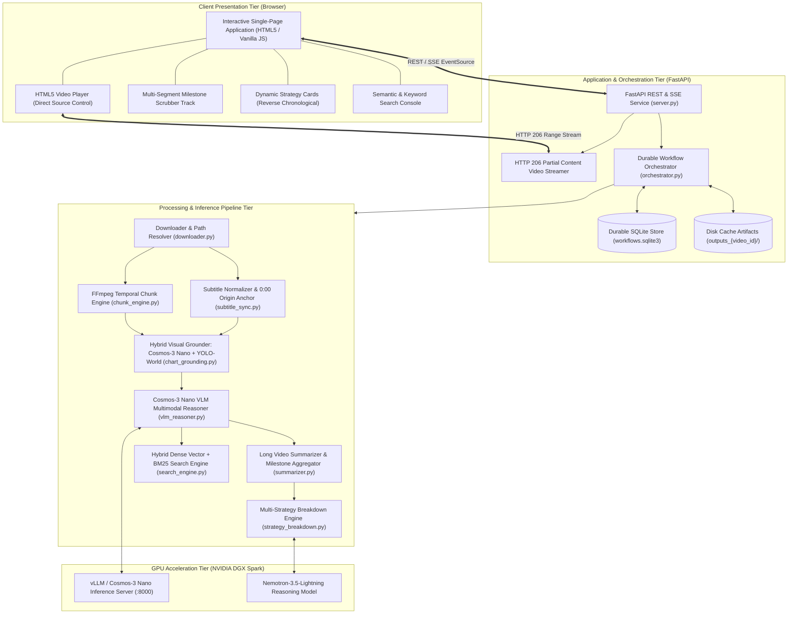
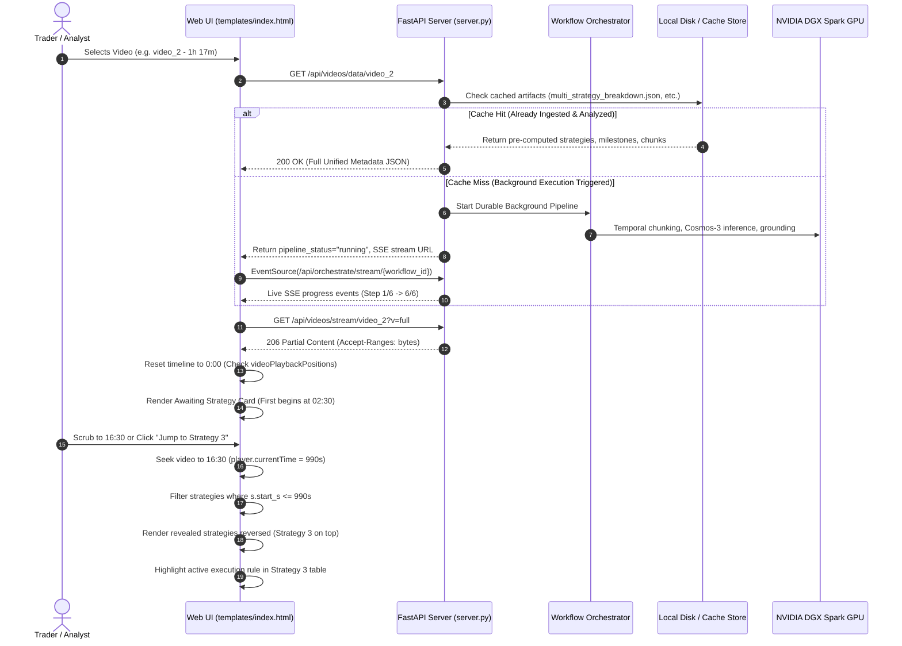

# 🏛️ Architecture & System Design: Trading Video Understanding

Comprehensive architectural specification and design decisions for the **NVIDIA Video Search and Summarization (VSS) Trading Pipeline & Interactive Video Intelligence Platform**.

---

## 📑 Table of Contents

1. [Executive Summary & Problem Statement](#1-executive-summary--problem-statement)
2. [High-Level System Architecture](#2-high-level-system-architecture)
3. [End-to-End Data Flow](#3-end-to-end-data-flow)
4. [Subsystem Deep Dives](#4-subsystem-deep-dives)
   - [4.1 Video Ingestion & HTTP 206 Streaming Engine](#41-video-ingestion--http-206-streaming-engine)
   - [4.2 Temporal Chunking & Subtitle Origin Anchoring](#42-temporal-chunking--subtitle-origin-anchoring)
   - [4.3 Multimodal Perception & Hybrid Visual Grounding](#43-multimodal-perception--hybrid-visual-grounding)
   - [4.4 Multi-Strategy Deconstruction Engine](#44-multi-strategy-deconstruction-engine)
   - [4.5 Durable Orchestration & Background Execution](#45-durable-orchestration--background-execution)
   - [4.6 Interactive Timeline & Live Playback Sync](#46-interactive-timeline--live-playback-sync)
   - [4.7 Semantic Search & Vector/BM25 Hybrid Retrieval](#47-semantic-search--vectorbm25-hybrid-retrieval)
5. [Key Design Decisions & Trade-Offs](#5-key-design-decisions--trade-offs)
6. [Recent Improvements & Optimizations](#6-recent-improvements--optimizations)
7. [Deployment & Infrastructure Topology](#7-deployment--infrastructure-topology)
8. [File Structure & Component Directory](#8-file-structure--component-directory)

---

## 1. Executive Summary & Problem Statement

Financial chart tutorials, masterclasses, and trading webinars represent dense, high-alpha educational media, yet they are notoriously difficult for conventional language models or video summarizers to parse:
- **Spatial Ambiguity (Deictic Expressions)**: Presenters frequently utter phrases like *"as you can see right here"*, *"this candle left and right"*, *"boom boom"*, *"at this exact level"*, or *"pulling back into this buy zone"*. Without fine-grained visual coordinate grounding, these verbal statements have zero quantitative meaning.
- **Heterogeneous Video Lengths**: Educational trading media ranges from short illustrative clips (2–3 minutes) to comprehensive masterclasses exceeding 1 hour (e.g., `video_1` at 39m 29s, `video_2` at 1h 17m 35s). Monolithic VLM contexts fail on hours of continuous video.
- **Multi-Strategy Complexity**: An hour-long masterclass does not describe a single trade idea; it deconstructs multiple, structurally distinct trading strategies across distinct temporal phases (trend following, liquidity sweeps, divergence exhaustion, breakout continuation, etc.).

This platform implements the **NVIDIA AI Blueprint for Video Search and Summarization (VSS)** with custom extensions for financial chart coordinate mapping, multi-strategy deconstruction, durable workflow execution, and an ultra-responsive, zero-friction interactive interface.

---

## 2. High-Level System Architecture



---

## 3. End-to-End Data Flow



---

## 4. Subsystem Deep Dives

### 4.1 Video Ingestion & HTTP 206 Streaming Engine
- **Files**: [`downloader.py`](file:///Users/armaankapoor/Desktop/coding/trading-video-understanding/downloader.py), [`server.py`](file:///Users/armaankapoor/Desktop/coding/trading-video-understanding/server.py)
- **High-Resolution Asset Storage**: Full masterclass videos (275 MB for `video_1`, 631 MB for `video_2`) are stored in `videos/`.
- **Candidate Path Prioritization**: `get_video_file_path(video_id)` checks `videos/{video_id}.mp4` first, ensuring that full videos are prioritized over legacy test fixture clips.
- **HTTP 206 Partial Content Streaming**:
  - Leverages Starlette's `FileResponse` with byte-range parsing (`Range: bytes=0-1024`).
  - Implements fast-seek capability without requiring the client to buffer hundreds of megabytes.
  - Returns `Cache-Control: no-cache, must-revalidate` to prevent stale media caching when switching video sources.
- **Web-VTT Subtitle Delivery**: Converts arbitrary subtitle formats (`.srt`, raw transcripts) on the fly into standards-compliant WebVTT via `SubtitleSyncManager`.

### 4.2 Temporal Chunking & Subtitle Origin Anchoring
- **Files**: [`chunk_engine.py`](file:///Users/armaankapoor/Desktop/coding/trading-video-understanding/chunk_engine.py), [`subtitle_sync.py`](file:///Users/armaankapoor/Desktop/coding/trading-video-understanding/subtitle_sync.py)
- **Dynamic Origin Normalization**: Many raw subtitle files from Video contain global video timestamps (e.g., starting at `18:40,000`). `SubtitleSyncManager` detects the earliest cue timestamp and shifts the origin to `00:00.000`, guaranteeing exact alignment with video playback.
- **Overlap-Aware Temporal Chunking**: Splits continuous video streams into discrete analysis windows (default: 20s chunks with 2s overlap), preventing trade entry triggers spanning window boundaries from being cut in half.
- **Keyframe Extraction**: Extracts representative high-fidelity frames from the center and endpoints of each chunk for visual chart analysis.

### 4.3 Multimodal Perception & Hybrid Visual Grounding
- **Files**: [`chart_grounding.py`](file:///Users/armaankapoor/Desktop/coding/trading-video-understanding/chart_grounding.py), [`vlm_reasoner.py`](file:///Users/armaankapoor/Desktop/coding/trading-video-understanding/vlm_reasoner.py)
- **Model Architecture**: Utilizes **NVIDIA Cosmos-3 Nano** (`Cosmos3OmniForConditionalGeneration` in BF16) paired with open-vocabulary detection (**YOLO-World**).
- **Price Coordinate Calibration**:
  - Translates normalized pixel bounding boxes `[ymin, xmin, ymax, xmax]` (scale 0–1000) to precise price coordinates on the chart's vertical y-axis.
  - Automatically identifies chart layout segmentation (price candle pane, volume pane, RSI/MACD oscillator sub-panes).
- **Deictic Spatial Grounding**:
  - Filters out presenter references ("here", "at this candle", "this level") and matches them against detected chart price pivots and swing highs/lows.
  - Detects trade signals: `BREAKOUT_LEVEL_VALIDATION`, `DEMAND_ZONE_RETEST`, `MOMENTUM_RSI_DIVERGENCE`, `PROTECTED_SWING_STOP`.

### 4.4 Multi-Strategy Deconstruction Engine
- **Files**: [`strategy_breakdown.py`](file:///Users/armaankapoor/Desktop/coding/trading-video-understanding/strategy_breakdown.py), [`trade_strategy_agent.py`](file:///Users/armaankapoor/Desktop/coding/trading-video-understanding/trade_strategy_agent.py)
- **Discrete Strategy Identification**: Deconstructs long webinars into distinct, self-contained trading strategies, each characterized by:
  - `name`: Strategy title (e.g., "Ascending Trend Following Strategy", "38.2% Candle Reversal Strategy").
  - `start_s` & `end_s`: Temporal window within the video.
  - `directional_bias`: BULLISH, BEARISH, or NEUTRAL.
  - `core_thesis`: The structural and fundamental market thesis.
  - `entry_trigger`, `invalidation_stop`, `take_profit_targets`, and `risk_reward_ratio`.
  - `step_by_step_rules`: Formally structured algorithmic rules with condition logic and execution actions.

### 4.5 Durable Orchestration & Background Execution
- **Files**: [`orchestrator.py`](file:///Users/armaankapoor/Desktop/coding/trading-video-understanding/orchestrator.py), [`server.py`](file:///Users/armaankapoor/Desktop/coding/trading-video-understanding/server.py)
- **SQLite Workflow Store**:
  - Thread-safe, durable state persistence in `workflows.sqlite3`.
  - Checkpoints step-by-step progress: `VIDEO_VALIDATION` -> `SUBTITLE_ALIGNMENT` -> `CHUNKING` -> `VISUAL_GROUNDING` -> `LVS_SUMMARIZATION` -> `STRATEGY_SYNTHESIS`.
- **Reactive Server-Sent Events (SSE)**: Streams step progress, percentage complete, and error diagnostics directly to the client browser without polling.
- **Zero-Friction Disk Caching**: On initial request to `/api/videos/data/{video_id}`, if pre-analyzed artifacts exist in `outputs_{video_id}/`, the orchestrator immediately serves the cached intelligence without re-triggering GPU inference.

### 4.6 Interactive Timeline & Live Playback Sync
- **Files**: [`templates/index.html`](file:///Users/armaankapoor/Desktop/coding/trading-video-understanding/templates/index.html)
- **Dynamic Revelation Along Timeline**:
  - Strategies are filtered by `currentTime >= strategy.start_s`.
  - At `00:00`, prior to the first strategy intro, a placeholder explains when the first strategy begins and provides a direct jump button.
- **Reverse Chronological Presentation**:
  - Strategies are rendered in reverse order (`[...revealed].reverse()`) so the **latest revealed strategy is always positioned at the very top of the screen**.
  - As the video progresses, new strategies appear immediately at the top without requiring the user to scroll down.
- **Sub-Second Scrubber Synchronization**:
  - Re-rendering is keyed on changes in revealed strategy IDs (`revealedKey`), preventing DOM destruction on every 4Hz `timeupdate` tick and ensuring smooth 60fps scrubbing.
  - Highlights the currently active strategy card and the specific active execution rule within its formal rules table.
- **Per-Video Timeline Stops**:
  - Maintains `videoPlaybackPositions[videoId]`.
  - When flipping videos, playback resets to `0:00` by default to avoid timestamp bleed across videos.
  - Displays a `▶ Resume (MM:SS)` button and renders a bookmark pin (`📌`) on the scrubber track, allowing 1-click resumption.

### 4.7 Semantic Search & Vector/BM25 Hybrid Retrieval
- **Files**: [`search_engine.py`](file:///Users/armaankapoor/Desktop/coding/trading-video-understanding/search_engine.py)
- **Hybrid Retrieval**: Combines dense vector cosine similarity (via sentence transformers) with lexical BM25 term weighting over synchronized transcripts and VLM chunk reasoning notes.
- **Instant Seeking**: Every search result includes an exact timestamp badge (`▶ [14:20 - 14:40]`) that jumps the video player directly to that event.

---

## 5. Key Design Decisions & Trade-Offs

| Decision | Alternative Considered | Rationale & Trade-Off |
|---|---|---|
| **Direct `<video src="...">` Management** | Child `<source>` elements | HTML5 specifies that dynamically modifying child `<source>` tags after DOM load causes undefined browser caching behavior. Direct attribute management on `<video>` enables reliable video flipping and cache busting. |
| **Reverse Strategy Ordering** | Chronological (top-to-bottom) | In 1+ hour videos with 7+ strategies, chronological ordering pushed newly revealed strategies far below the fold. Reverse ordering keeps the active strategy directly in view at the top of the viewport. |
| **Client-Side Filtered Revelation** | Backend pagination on every seek | Filtering the full pre-loaded strategy list on `timeupdate` provides instant zero-latency UI updates without server roundtrips, while the keyed DOM updates prevent layout thrashing. |
| **Frequency-Based Ticker Extraction** | First-token regex match | In dense technical tutorials, an LLM narrative may mention comparative assets (e.g., comparing a breakout level at 1927 to Gold `XAU/USD`). Frequency counting (`Counter.most_common`) reliably extracts the primary asset under analysis (e.g., `NVDA`). |
| **Separate Code & GPU Execution Tiers** | All-in-one local GPU machine | The user's local Mac stores the codebase and runs the UI/dev server, while heavy inference (Cosmos-3 Nano, Nemotron-3.5) runs exclusively on the remote NVIDIA DGX Spark in Docker. |
| **SQLite Durable Orchestration** | Celery / Redis | Avoids heavy infrastructure dependencies. SQLite provides ACID-compliant durable checkpointing, single-file portability, and zero daemon overhead. |

---

## 6. Recent Improvements & Optimizations

1. **Full-Length Video Playback Resolution**:
   - Replaced short 2-minute clips (`trading_lesson.clip.mp4`) with full masterclasses (`videos/video_1.mp4`, 39m 29s and `videos/video_2.mp4`, 1h 17m 35s).
   - Resolved candidate path resolution in `downloader.py` to prioritize full video files.

2. **Video 2 Streaming & Jump Fix**:
   - Resolved browser media cache lock that clamped Video 2 to a 1:53 clip.
   - Added `Cache-Control: no-cache, must-revalidate` to `FileResponse` in `server.py`.
   - Appended `?v=full` cache-busting to stream URLs in the UI, enabling instant seeking to Strategy 1 at 02:30.

3. **Per-Video Saved Timeline Positions**:
   - Implemented `videoPlaybackPositions` state dictionary.
   - Flipping videos resets playback cleanly to `0:00` while preserving previous timestamps.
   - Added interactive timeline bookmark pins (`📌`) and a `▶ Resume (MM:SS)` action button.

4. **Streamlined Bare-Bones Interface**:
   - Removed redundant HUD cards (`#grounding-hud`), extraneous metadata boxes, and confusing toggle switches.
   - Cleaned player controls: `-5s`, `+5s`, speed controls (`0.75x`, `1x`, `1.25x`, `1.5x`), `↺ 00:00` reset, and `▶ Resume`.

5. **Frequency-Based NLP Heuristics**:
   - Upgraded `extract_ticker_symbol()` in `utils.py` to use `collections.Counter`, eliminating false-positive ticker assignments during strategy synthesis.

---

## 7. Deployment & Infrastructure Topology

```
┌────────────────────────────────────────────────────────┐
│                   LOCAL MAC WORKSPACE                  │
│  - Code Repository: ~/Desktop/coding/trading-video-... │
│  - FastAPI Web Service: http://localhost:8088          │
│  - Browser Client UI & Video Playback                  │
└───────────────────────────┬────────────────────────────┘
                            │ rsync / SSH
                            ▼
┌────────────────────────────────────────────────────────┐
│              DGX Spark DGX SPARK GPU SERVER                 │
│  - Remote Path: ~/Desktop/coding/trader-vids           │
│  - Docker Container: trader-vids:latest                │
│  - vLLM Service (:8000): Cosmos-3 Nano & Nemotron-3.5  │
│  - Execution Environment for Pytest & Heavy Pipelines │
└────────────────────────────────────────────────────────┘
```

---

## 8. File Structure & Component Directory

```
trading-video-understanding/
├── architecture.md           # This document: comprehensive architectural specification
├── README.md                 # Project overview and quickstart instructions
├── config.py                 # Dataclasses and environment configuration
├── schemas.py                # Pydantic schemas (VSS OpenAPI and data contracts)
├── utils.py                  # Shared helpers (NLP heuristics, JSON cleaning, safe loaders)
├── subtitle_sync.py          # Dynamic subtitle parsing, 0:00 origin anchor, and alignment
├── chunk_engine.py           # FFmpeg-based temporal slicing and frame extraction
├── downloader.py             # Video/subtitle path resolver and metadata registry
├── chart_grounding.py        # Cosmos-3 Nano + YOLO-World hybrid visual grounding
├── vlm_reasoner.py           # Multimodal chart perception and reasoning engine
├── nemotron_reasoner.py      # OpenAI-compatible Nemotron 3.5 Lightning client
├── strategy_breakdown.py     # Multi-strategy segment breakdown and rule extraction
├── summarizer.py             # Long Video Summarization (LVS) and milestone aggregator
├── trade_strategy_agent.py   # Algorithmic trade idea and execution rule synthesizer
├── search_engine.py          # Hybrid dense vector and BM25 search index
├── orchestrator.py           # Durable SQLite workflow orchestrator with SSE
├── pipeline.py               # Master end-to-end VSS pipeline runner
├── server.py                 # FastAPI microservice implementing REST and HTTP 206 streaming
├── templates/
│   └── index.html            # Single-page interface with live timeline sync and playback
├── videos/                   # Full-length masterclass video MP4s and WebVTT subtitles
│   ├── video_1.mp4       # Video 1: NVDA Market Structure Masterclass (39m 29s, 275MB)
│   ├── video_1.vtt       # Video 1 Subtitles
│   ├── video_2.mp4       # Video 2: Full Technical Analysis Course (1h 17m 35s, 631MB)
│   └── video_2.vtt       # Video 2 Subtitles
└── tests/                    # Comprehensive unit and integration test suite (32 tests)
    ├── test_api_server.py
    ├── test_chart_grounding.py
    ├── test_chunk_engine.py
    ├── test_orchestrator.py
    ├── test_search_engine.py
    ├── test_subtitle_sync.py
    ├── test_trade_strategy.py
    └── test_utils.py
```
