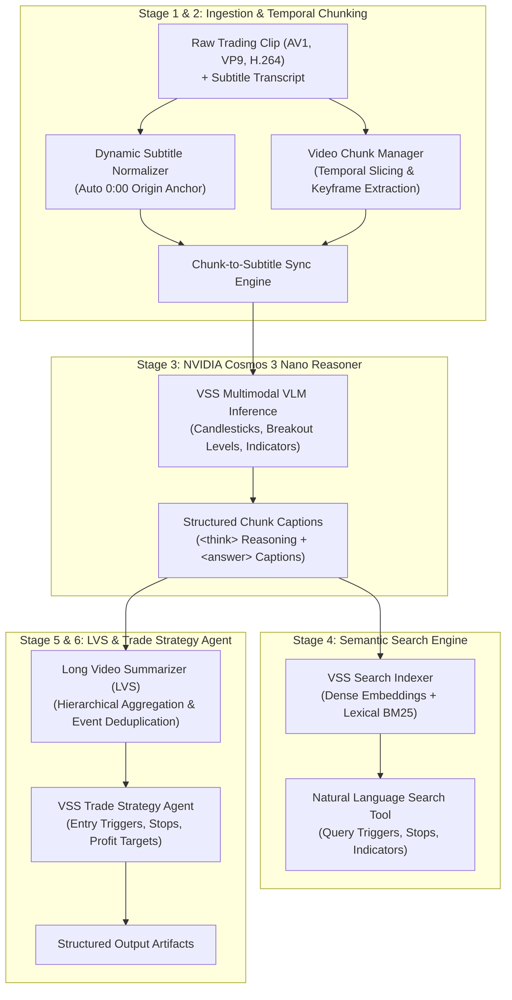

# 🎬 NVIDIA Video Search and Summarization (VSS) Trading Pipeline

Implementation of the **NVIDIA AI Blueprint for Video Search and Summarization (VSS)** tailored specifically for extracting actionable trading ideas, market structure rules, and execution plans from technical trading video clips and synchronized subtitles.

Reference architecture based on:  
[NVIDIA-AI-Blueprints/video-search-and-summarization](https://github.com/NVIDIA-AI-Blueprints/video-search-and-summarization)

---

## 💡 Overview & Problem Statement

Financial chart tutorials and trading webinars rely heavily on informal, ambiguous verbal phrases:
- Presenters say: *"as you can see here"*, *"this candle left and right"*, *"boom boom"*, *"at this particular point is 1927"*, *"nice buy zone in between this level"*.
- Without visual perception, an LLM cannot ground these statements into actionable trading parameters.

The **NVIDIA VSS Trading Pipeline** replaces ad-hoc scripts with the official **NVIDIA VSS Blueprint reference architecture**, enhanced to natively support:
1. **Arbitrary video codecs** (AV1, VP9, H.264) via streaming FFmpeg pipes.
2. **Dynamic clip and subtitle synchronization** (automatically detecting the clip's offset, e.g. `18:40` or `39:46`, and anchoring it to `0:00`).
3. **Multimodal chart reasoning** with **NVIDIA Cosmos 3 Nano** (`Cosmos3OmniForConditionalGeneration` in BF16) on GPU.
4. **Hybrid semantic search** over indexed video intervals (dense vector embeddings + lexical BM25).
5. **Long Video Summarization (LVS)** aggregating chunk-level observations into chronological trading milestone events.
6. **Algorithmic trade idea synthesis** generating formal execution rules (entry triggers, invalidation stops, profit targets, and confluences).

---

## 🏗️ Architecture



---

## 📂 Subdirectory Structure

```
video_search_and_summarization/
├── __init__.py               # Package metadata and versioning
├── config.py                 # Dataclasses and environment configurations
├── schemas.py                # Pydantic schemas (VSS OpenAPI and data contracts)
├── subtitle_sync.py          # Dynamic subtitle parsing, 0:00 anchoring, and window alignment
├── chunk_engine.py           # FFmpeg-based video chunking and frame extraction
├── vlm_reasoner.py           # Cosmos 3 Nano multimodal perception and reasoning engine
├── search_engine.py          # Hybrid vector and keyword semantic search index
├── summarizer.py             # Long Video Summarization (LVS) and milestone event aggregator
├── trade_strategy_agent.py   # Algorithmic trade idea and execution rule synthesizer
├── pipeline.py               # Master end-to-end VSS pipeline runner
├── vss_cli.py                # Unified CLI (summarize, search, trade-idea, serve)
├── server.py                 # FastAPI microservice implementing VSS REST endpoints
├── README.md                 # Complete documentation and usage instructions
└── tests/                    # Comprehensive unit tests
    ├── test_api_server.py
    ├── test_chunk_engine.py
    ├── test_search_engine.py
    ├── test_subtitle_sync.py
    └── test_trade_strategy.py
```

---

## 🚀 Running on NVIDIA DGX Spark GPU Server

The pipeline executes inside the Docker container on the NVIDIA DGX Spark GPU system (`ssh user@dgx-spark`).

### 1. Run on Clip 1 (NVDA Market Structure & Demand Retest):
```bash
ssh user@dgx-spark "docker run --rm --gpus all \
  -v /workspace:/workspace \
  -v /mnt/edrive/huggingface:/mnt/edrive/huggingface:ro \
  -e HF_HOME=/mnt/edrive/huggingface \
  -e WANDB_MODE=offline \
  trader-vids:latest -m video_search_and_summarization.pipeline \
  --video /workspace/trading_lesson.clip.mp4 \
  --subtitles /workspace/subtitles_clip \
  --output_dir /workspace/outputs_vss_clip_1 \
  --chunk_duration 35.0 \
  --chunk_overlap 5.0"
```

### 2. Run on Clip 2 (RSI Momentum Divergence & Resistance Reversal):
```bash
ssh user@dgx-spark "docker run --rm --gpus all \
  -v /workspace:/workspace \
  -v /mnt/edrive/huggingface:/mnt/edrive/huggingface:ro \
  -e HF_HOME=/mnt/edrive/huggingface \
  -e WANDB_MODE=offline \
  trader-vids:latest -m video_search_and_summarization.pipeline \
  --video /workspace/trading_lesson_2.clip.mp4 \
  --subtitles /workspace/subtitles_clip_2 \
  --output_dir /workspace/outputs_vss_clip_2 \
  --chunk_duration 35.0 \
  --chunk_overlap 5.0"
```

### 3. Run on Any New Video:
```bash
ssh user@dgx-spark "docker run --rm --gpus all \
  -v /workspace:/workspace \
  -v /mnt/edrive/huggingface:/mnt/edrive/huggingface:ro \
  -e HF_HOME=/mnt/edrive/huggingface \
  -e WANDB_MODE=offline \
  trader-vids:latest -m video_search_and_summarization.pipeline \
  --video /workspace/my_video.mp4 \
  --subtitles /workspace/my_subtitles \
  --output_dir /workspace/outputs_vss_my_video"
```

---

## 🔍 VSS Semantic Video Search

After running the pipeline, query the video index directly with natural language:

```bash
# Query breakout levels
python3 -m video_search_and_summarization.vss_cli search \
  --index outputs_vss_clip_1/vss_search_index.json \
  --query "Where does the price break above the swing high?"

# Query entry triggers and buy zones
python3 -m video_search_and_summarization.vss_cli search \
  --index outputs_vss_clip_1/vss_search_index.json \
  --query "Where is the consolidation demand buy zone?"
```

---

## 🌐 VSS REST API Service

Launch the FastAPI microservice adhering to the VSS OpenAPI contract:

```bash
python3 -m video_search_and_summarization.vss_cli serve --port 38111 --host 0.0.0.0
```

Available endpoints:
- `GET /v1/ready`: Service readiness probe (HTTP 200).
- `GET /v1/live`: Service liveness probe (HTTP 200).
- `GET /v1/healthz`: Health status with real-time GPU VRAM profiling.
- `GET /models`: Lists available models (`nvidia/Cosmos3-Nano`).
- `POST /v1/summarize`: Executes long video summarization on a video clip and subtitle file.
- `POST /v1/search`: Executes semantic search across video chunks.
- `POST /v1/trade_idea`: Synthesizes formal trade rules and execution parameters.

---

## 📦 Output Artifacts

Each pipeline run generates the following artifacts in the designated output directory:
1. `trading_summary.json`: Standard VSS `CompletionResponse` containing the narrative summary, chronological milestone events, and chunk captions.
2. `trading_summary.md`: Human-readable summary report with comparative milestone tables.
3. `trading_strategy_spec.json`: Machine-readable algorithmic trading rules (entry triggers, invalidation stops, profit targets, indicators).
4. `trading_strategy_spec.md`: Polished markdown trade plan for algorithmic execution.
5. `vss_search_index.json`: Vector and keyword search index enabling instant query retrieval.
6. `augmented_subtitles.json` & `augmented_subtitles.md`: Grounded timeline linking spoken subtitle blocks to visual chart confluences.
